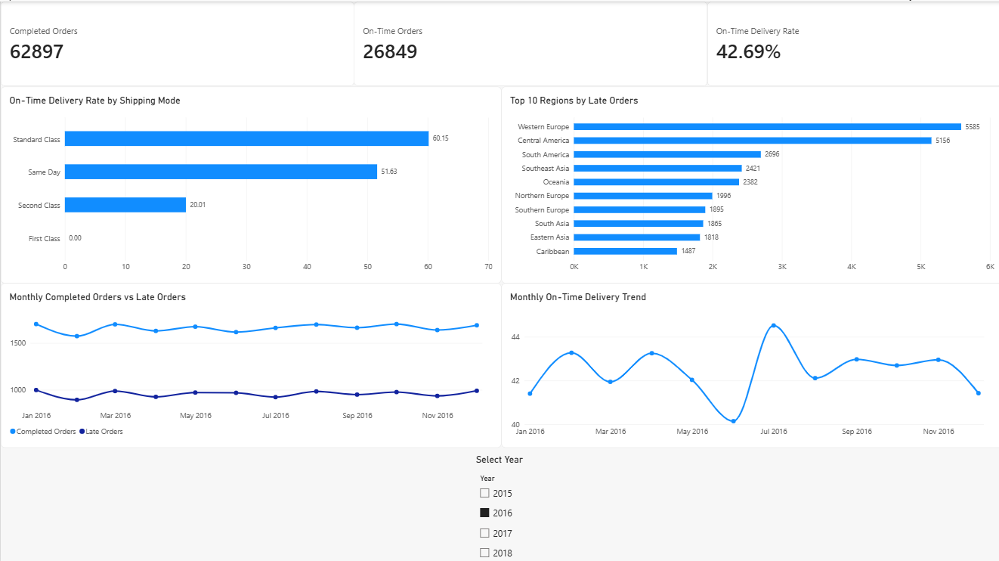

# Automated Logistics KPI Reporting System

An end-to-end logistics analytics project using Python, MySQL,
Pandas, and Excel to automate supply chain KPI reporting.

## Project Overview

This project transforms raw supply chain order data into
structured SQL tables and automated Excel performance reports.

The objective is to reduce manual reporting effort and
improve visibility into logistics delivery performance.


## Power BI Dashboard



The interactive Power BI dashboard visualizes logistics performance using automated KPI reports generated from MySQL through Python.

### Dashboard Features

- **KPI Overview:** 62,897 completed orders, 26,849 on-time orders, and a 42.69% on-time delivery rate.
- **Shipping Mode Analysis:** Compares delivery performance across Standard Class, Same Day, Second Class, and First Class.
- **Regional Performance:** Highlights the top 10 regions by late order volume.
- **Monthly Delivery Trends:** Tracks on-time delivery performance over time.
- **Completed vs Late Orders:** Compares monthly order volumes and delivery delays.
- **Year Filter:** Allows users to interactively explore monthly performance trends.

### Automation Workflow

MySQL Database → Python Reporting Script → Excel Reports → Power BI Dashboard

The Python reporting script is scheduled using Windows Task Scheduler and produces both timestamped historical reports and a fixed-name Excel workbook for Power BI refresh.

**Note:** Power BI Desktop refresh is currently manual; the underlying Excel report generation is automated.

## Technology Stack

- Python
- Pandas
- MySQL
- MySQL Connector
- OpenPyXL
- Jupyter Notebook
- Excel

## Dataset

DataCo Smart Supply Chain Dataset (Kaggle).

- 180,519 order-item records
- 65,752 unique orders
- Normalized into orders and order_items tables

The raw dataset is excluded from this repository.

## Logistics KPIs

1. Overall On-Time Delivery Rate
2. Shipping Mode Performance
3. Regional Delivery Performance
4. Sales by Delivery Status
5. Shipping Schedule Variance
6. Monthly Delivery Performance

## Key Findings

- Completed orders: 62,897
- On-time orders: 26,849
- Overall on-time delivery rate: 42.69%

These metrics are calculated at the order level, excluding
canceled orders from delivery performance calculations.

## Reporting Automation

The Python script:

1. Connects securely to MySQL using environment variables.
2. Executes six SQL KPI queries.
3. Converts results into Pandas DataFrames.
4. Generates a formatted multi-sheet Excel workbook.
5. Logs execution results and errors.

## How to Run

Install dependencies:

```bash
pip install -r requirements.txt
```

Create a `.env` file in the project root:

```text
DB_HOST=localhost
DB_PORT=3306
DB_USER=your_mysql_user
DB_PASSWORD=your_mysql_password
DB_NAME=logistics_kpi
```

Create the database using `sql/01_create_tables.sql`,
then load the cleaned dataset into the tables.

Run the report:

```bash
python src/generate_reports.py
```

Reports are saved to the `reports/` directory.

## Future Enhancements

- Windows Task Scheduler integration
- Incremental data ingestion
- Automated data quality validation
- Power BI dashboard

## Notes

This is a portfolio project using a public dataset.
The results are illustrative and do not represent
real-time operational performance.
